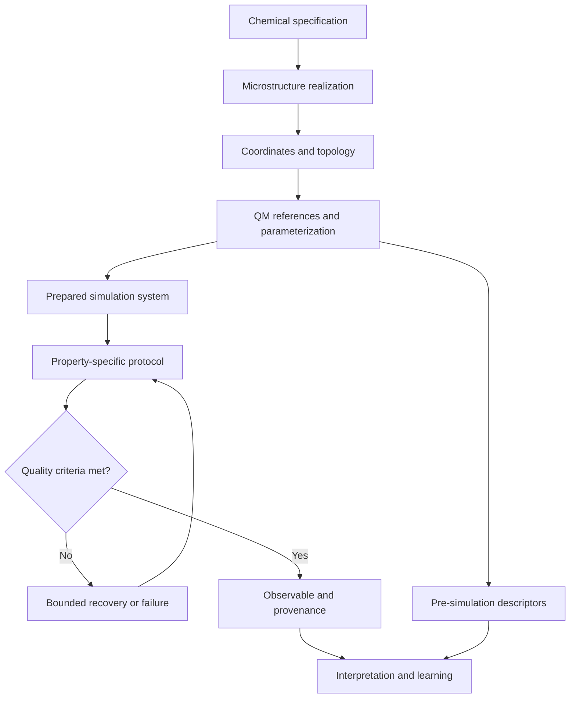

# PolyChemMD architecture

Status: independent development core, 7 November 2026.

PolyChemMD is intended to become a general polymer chemistry and molecular-simulation library. Its domain objects, construction algorithms, orchestration, descriptors and analysis code are developed independently. RadonPy is a comparison target and literature source, not a runtime dependency. General numerical, cheminformatics and simulation software can be external dependencies with explicit versions and attribution.

## Implemented boundary

The core contains input-record validation, mapped repeat-unit contracts, supported linear molecular-graph assembly, immutable geometry records, seeded RDKit ETKDGv3 coordinates, independent rigid cell packing, structure exports, Fourier-torsion analysis/conversion, sourced n-alkane assignments, isolated and periodic Ewald energy/force references, bounded LAMMPS verification/preparation and density diagnostics. It now assembles supported fully assigned periodic starting cells and executes finite minimization/NVT/NPT pilots. It does not establish equilibrated polymer states, production sampling, validated polymer-property MD/QM or experimental predictivity. Graph, geometry, parameter identity, numerical parity and process execution are separate from equilibrium/material validation.

`geometry.py` owns the dependency-free molecular coordinate contract.
`builders/conformers.py` consumes validated linear graphs and invokes optional
RDKit only when requested; its own graph/lineage and 3D stereo checks surround
that backend. `builders/packing.py` consumes immutable geometries without RDKit,
using bounded rigid placements and a periodic all-pair audit. `io/xyz.py` exports
viewing coordinates without converting supplied provenance into verified claims.

`forcefields/alkane_parameters.json` contains only a selected, independently
structured numerical subset with exact upstream source identity; no upstream
workflow is imported. `alkanes.py` validates a neutral explicit n-alkane graph,
assigns its fixed charges and enumerates the complete bonded/pair topology.
Its serialized constructor rejects changes that would mislabel a modified
assignment as the frozen model. `reference.py` evaluates explicit energy
equations and their local analytic derivatives without a simulation engine.
`engines/alkane.py` exports the same model and compares actual LAMMPS run-zero
components and forces. Shared parameter values are intentional; independent
numerical implementations test conventions/derivatives, not fitted accuracy.

`forcefields/periodic.py` revalidates the packed-source geometry, images and
global/source identities before combining frozen molecular assignments.
`periodic_reference.py` evaluates explicit finite Ewald sums and analytical
forces, including special-pair corrections, reciprocal/self terms and numerical
work limits. `engines/periodic_alkane.py` exports the same declared periodic
model and compares actual component energies/forces; it records source-scoped
backend numerical approximations. Its scientific setup helper is reused by
`protocols/alkane.py`, whose finite preparation stages retain minimizer stopping
status, actual step counts and final state. Process completion cannot promote a
short pilot into an equilibrium or density-validation result.

`protocols/restart.py` separates evolved MD state from immutable source geometry.
It consumes a hash-bound native checkpoint and original assignment, verifies the
producer engine/configuration and restores the named NPT fix without resetting
time or velocities. Native binary staging belongs to the process adapter.
`analysis/sampling.py` checks physical-time density series and keeps independent
cell summaries distinct from frame-level diagnostics. `protocols/campaign.py`
validates declared phase/state hypotheses, seeds, durations, sensitivities and
resource/cell-capacity limits without dispatching a campaign. These foundations
leave the complete TASK-006 density qualification open.

`forcefields/periodic.py` additionally exposes compact schema 2: the default
unit nonbonded scale and sparse graph-distance-1/2/3 exceptions replace global
all-pair storage. Exact pair counts are algebraic; per-molecule typing/rigidity
work remains bounded and explicit. Legacy schema 1 is retained unchanged.
`builders/tiling.py` constructs ordered motif cells and checks periodic contacts
with linked bins. It does not infer an equilibrated phase. The engine accepts
both representations; the independent analytical reference remains deliberately
small and explicitly budgeted. Larger-cell engine results and fixed-geometry
numerical sensitivity are separate evidence from small-cell reference parity.

`engines/periodic_thermo.py` separately exports static virial scalar/tensor
pressure, energies and forces with zero-velocity/native-unit audits.
Large periodic setups and native continuation share an explicit size-derived
neighbor-storage policy; storage capacity does not change the physical cutoff.
`protocols/numerics.py` prespecifies all fixed-geometry refinement points,
source/engine identity, consecutive-finest comparison gates and aggregate
resources before executing them. `analysis/structure.py` computes static chain
dimensions and apolar order from chemically ordered, unwrapped backbones.
`analysis/readiness.py` reviews full actual preparation records and recomputes
structure/force/sampling consistency; it keeps initial-geometry numerical
coverage distinct from the evolved MD state. Thermal forces are not minimizer
residuals. These calculations extend configuration analysis without promoting
any snapshot or numerical sweep into a validated material ensemble.

The names below describe architectural responsibilities; they do not assert that all listed Python classes or modules already exist.

## Layers and ownership

| Layer | Responsibility | Main contracts |
| --- | --- | --- |
| Chemistry | Repeat units, atom maps, attachment sites, termini and reaction transformations | Explicit graph, formal charge, stereochemistry and atom lineage |
| Microstructure | Sequence, tacticity, chain-length distribution, branches and networks | Target distribution, realized distribution, sampling assumptions and seed |
| Builders | Chains, packed cells, solutions, films, interfaces and crystals | Geometry, topology, periodic cell, collision and chemical checks |
| Quantum | Conformers, charge models, torsion scans, response and interaction references | Method, basis/model, charge, multiplicity, geometry and convergence |
| Force fields | Parameter lookup, assignment, fitting, transfer and coverage | Functional forms, units, exclusions, scaling and parameter provenance |
| Engines | Isolated interfaces to LAMMPS, QM engines and later other solvers | Structured inputs, executable/version discovery and fresh artifacts |
| Protocols | Property-specific preparation, equilibration, production and recovery | Explicit state transitions and finite retry budgets |
| Analysis | Observables, uncertainties, spectra, tensors and mechanism descriptors | Validated inputs, estimator definition and sampling diagnostics |
| Informatics | Feature tables, prediction, interpretation and candidate selection | Split identity, feature availability, applicability and cost |
| Validation | Analytical checks, engine parity, numerical convergence and external evidence | Test level, acceptance margin and independent reference |

## Data flow

Recovery must stop when its budget is exhausted. An unresolved failure is a recorded outcome, not a request to substitute a plausible value.

## Core object boundaries

1. **Chemical specification:** identity and intended connectivity. A free monomer, polymer repeat unit and capped oligomer are distinct objects.
2. **Material specification:** polymer ensemble, phase, composition and environmental state. A repeat-unit SMILES alone is not a complete material specification.
3. **Realization:** a particular finite graph and geometry drawn from that specification; its seed and realized statistics are retained.
4. **Parameter set:** a complete potential definition with explicit unit and functional-form conventions. Atom typing is not a validation result.
5. **Run specification:** immutable scientific inputs, engine requirements, protocol and resource request. Scheduler settings do not silently change scientific inputs.
6. **Run record:** actual engine identity, start/end information, file hashes, process status and convergence evidence.
7. **Observable result:** value or array, units, method, conditions, uncertainty, sampling limitations and evidence level.

## Dependency rules

- Keep domain validation independent of installed MD/QM executables.
- Provide optional engine and cheminformatics dependencies. Importing the lightweight core must not launch an engine or require a GPU.
- Keep engine adapters separate from scientific estimators. An estimator should be testable with a controlled trajectory/reference array.
- Preserve atom maps across chemical transformations, coordinate generation and engine export/import.
- Parse subprocess arguments as argument lists. Do not construct executable shell strings from chemical labels or file names.
- Never infer successful execution from a zero exit code alone: require expected, nonempty, current-run artifacts and explicit convergence checks.
- Persist large trajectories outside Git; retain small manifests, hashes, input recipes and retrieval instructions.
- Define property-specific suitability rules. Density equilibration alone cannot certify viscosity or ion transport.

## Independent development workflow

Use one branch or worktree per bounded change. Assign exclusive file ownership when tasks run in parallel; integrate through reviewed changes. Do not let multiple tasks redesign the same shared schema simultaneously. Freeze a schema version before independent builder, engine and analysis tasks consume it.

The first dependency chain is chemical contract → mapped-chain builder → parameter contract → engine adapter → one validated end-to-end observable. Broad property families remain on the roadmap until their own protocol and acceptance evidence exist.

## References

- RadonPy, comparison software: https://github.com/RadonPy/RadonPy
- Polymer parameterization precedent: https://doi.org/10.1021/acs.jcim.3c01691
- BigSMILES: https://doi.org/10.1021/acscentsci.9b00476
- LAMMPS finite-temperature elasticity: https://docs.lammps.org/stable/Howto_elastic.html
- LAMMPS viscosity methods: https://docs.lammps.org/Howto_viscosity.html

These references establish context and reusable scientific methods; they are not evidence that the planned PolyChemMD modules have been implemented or validated.
