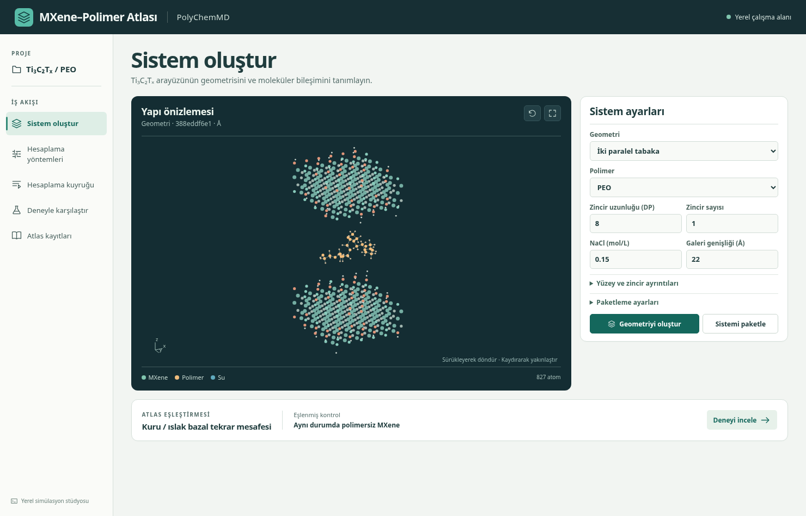

# MXene–Polimer Simülasyon Stüdyosu

PolyChemMD’ye eklenen yerel uygulama, bir araştırma reçetesini atom koordinatlarına, uygun kuvvet alanıyla çalıştırılmış bir yörüngeye veya eşlenmiş bir deneysel sonuca dönüştürür. Her işin kendine ait girdileri, çıktıları, birimleri ve SHA-256 kaydı vardır.



## Kurulum

Tam kurulum için Linux veya Windows üzerinde WSL2 ve **Python 3.12** kullanın. Kaynak depodan:

```bash
git clone https://github.com/burhanbeycan/PolyChemMD.git
cd PolyChemMD
python3.12 scripts/start_mxene_studio.py --full --open
```

Bu komut iki sanal ortam oluşturur. Biri Studio, iki harici paketleyici, LAMMPS, MDAnalysis ve Moltemplate içindir. Diğeri RadonPy içindir. İlk çalıştırmada Python paketleri ve yaklaşık 114 MB’lık kaynak model arşivi indirilir. İndirilen kaynağın özeti doğrulanır ve iki OPLS girdisi yeniden kurulur. Uygulama **http://127.0.0.1:8765** adresinde dinler. Tarayıcı otomatik açılmazsa adresi elle açabilirsiniz. `--setup-only` yalnızca kurar. GUI, zincir, yerel paketleyici ve deney modülleriyle daha küçük bir kurulum için `--full` seçeneğini çıkarın. Tam model hazırlığı ve LAMMPS testleri CPU üzerinde yapılmıştır. GPU kullanımı gerekmiyor.

Daha önce verilen araştırma arşivindeki MATCH/CGenFF modellerini de kullanmak için tam kurulum sırasında `--atlas /yerel/yol/MXene_Polimer_Atlasi_Arastirma_Paketi.zip` ekleyin. İstenirse kaynak modeller ağsız bir makineye önceden taşınabilir. [Kaynak modeller, lisans kapsamı ve bağımsız doğrulama](STUDIO_IFF.md).

Daha sonraki çalıştırmalar için ortamları tekrar kurmaya gerek yoktur:

```bash
source .studio-env/bin/activate
export POLYCHEMMD_RADON_PYTHON="$PWD/.studio-env-radon/bin/python"
polychemmd studio doctor
polychemmd studio serve
```

## Ekranda ilk çalışma

1. **Sistem oluştur.** Ti₃C₂Tₓ için tek yüzey veya iki düzlem seçin. PEO, PVA, PVP, PEtOx, nötr doğrusal PEI, tanımlı model PCE veya polimersiz kontrol oluşturulabilir. PVA hidroliz derecesi ile kalan asetatların dizilişini, PCE için PEG yan zincir uzunluğu ile aşı periyodunu belirleyin. OH/F oranları iki yüzde ayrı seçilir. Başlangıçtaki galeri genişliği kullanıcı girdisidir.
2. **Sistemi paketle.** Çözücü yüksekliği, su yoğunluğu, polimer sayısı, NaCl ve motoru seçin. PEO DP8, tek tabaka ve varsayılan kutuda bu sürüm 283 su ve bir tuz çifti üretir. İstenen 0,15 M için bu hacimdeki gerçekleşen değer yaklaşık 0,195 M'dır. Kutu boyutu ve çözünmüş parçacığın dışladığı hacim önemlidir. Rapor başlangıç mesafelerini, atom kimliğini, periyodik çakışmaları ve nominal polimer yüklemesini kaydeder.
3. **Hesaplama yöntemleri.** Hazır IFF sistemleri için termal başlangıç ve dinamiği çalıştırın. Referans düzenek dış suya açılan, sabit iki tabakalı bir yüzeydir. IFF–OPLS veya IFF–MATCH/CGenFF ile tam tanımlı DP12 zinciri, %75 hidroliz, kümeli/dağılmış asetat dizisi seçilir. Su kontrolü ve polimer için iki ayrı kuvvet alanı profili 0,5 fs adımla sınanmıştır. Yeni bir paketlenmiş yapıya yerel olarak kayıtlı tam bir topoloji eşlenebilir. Sisteme atanmış bağ, yük ve çapraz parametrelerin doğruluğu eşleşmeden ayrı bir bilimsel değerlendirmedir.
4. **Kuyruk ve yörünge.** Tamamlanmış işin 3B yapısı, özeti, kaynak bilgileri ve indirilebilir dosyaları kuyruktan açılır. LAMMPS çalışmasının kaydedilmiş karelerinden yüzeye dik sayı yoğunluğunu, su O ve ağır polimer atomlarının temas oranını ve iki merkezi Ti düzlemi arasındaki uzaklığı hesaplayın. Sabit tutulan düzlemler için çıkan mesafe kısıtın geometrisini gösterir. Denge (d_{002}) ya da uzun süreli optik tutunum için serbest örnekleme ve ayrı deney gerekir.
5. **Deneyle karşılaştır.** 39 kaynaklı kaydı polimer veya yöntemle arayın. Deney girişi kuru/ıslak XRD için dört eşlenmiş gözlemi, optik deney için başlangıç/24 saat absorbansı ile iki arka plan okumasını kabul eder. Kendi ölçümünüz ve kaynak yayının verisi ayrı etiketlenir. Xing ve arkadaşlarının PEI deneyi için Δkuru = +0,060 nm, Δıslak = −0,112 nm, çift fark = −0,172 nm yeniden hesaplanır. Bu karşılaştırma yeni laboratuvar ölçümü içermez.

## 7/24 yerel işçi ve deney tasarımı

Varsayılan çalışmada web süreci ve bir işçi birlikte açılır. Sekmeyi kapatmak işçiyi durdurmaz. Sunucuyu yeniden başlatırken simülasyon sürecinin kesilmemesi için ayrı terminallerde aşağıdaki komutları aynı veri diziniyle çalıştırın. Hesapların devamı için iş istasyonu açık ve uyanık kalmalıdır.

```bash
polychemmd studio --data-dir ./artifacts/studio serve --external-worker
polychemmd studio --data-dir ./artifacts/studio worker
```

Bir karşılaştırma kampanyası için:

```bash
polychemmd studio --data-dir ./artifacts/studio campaign examples/studio/campaign.json
polychemmd studio --data-dir ./artifacts/studio campaign-status KAMPANYA_KIMLIGI
```

`model` amacı eşlenmiş OPLS ve MATCH/CGenFF çalıştırır. `termination` sonlanma desenini, `hydrolysis` ise sabit asetat oranında asetat dizilişini karşılaştıran paketleme işleri açar. Her iki kolda aynı başlangıç tohumu, tekrarlar arasında bağımsız tohumlar kullanılır. Karşılaştırma paketin veya sonlu MD yörüngesinin ölçeğinde raporlanır. İki kolu da tamamlanmamış eşler kayıtlı kalır. Belirsizlik bağımsız eşlere göre hesaplanır. Örnek kampanyanın `model` kolları için her iki parametre takımı da hazırlanmış olmalıdır.

Yerel önerici dil modeli olmadan çalışır. Ollama kullanacaksanız kurulu yerel modelin etiketini girin. Örnek: `polychemmd studio plan --objective termination --model smollm2:135m-instruct-q4_K_M`. Önerici, hesabın yayın değerini veya sonucunu belirlemez. İki kayıtlı koşul önerir. Geçersiz yanıtlar işe dönüştürülmez. Eşlenmiş kampanyanın kuyruk işlemleri sayı bütçesiyle sınırlıdır.

## Geliştirici için

| Dosya | Sorumluluk |
|---|---|
| `src/polychemmd/studio/geometry.py`, `packing.py` | Yüzey ve zincir kimliği, koordinat üretimi, motor dönüştürücüleri ve geometrik denetim |
| `iff_sources.py`, `md.py` | Kaynak model doğrulama, kanonik LAMMPS tarifleri, kontrollü yeniden başlatma |
| `topology_file.py`, `register_topology.py` | Yerelde sağlanan topolojiyi tam olarak aynı paketli yapıya bağlama, sınırlı LAMMPS protokolü |
| `trajectory.py`, `experiment.py` | Yörüngedeki gözlenebilirler, DOI kayıtları, gerçek ölçümlerin eşlenmiş analizi |
| `radon.py`, `_radon_runner.py` | Ayrı yorumlayıcıda RadonPy karşılaştırma ve GAFF2 atom tipi denetimi |
| `jobs.py`, `operations.py`, `campaign.py` | SQLite iş sahipliği, hata ve dosya kayıtları, hesap dağıtımı, eşlenmiş karşılaştırmalar |
| `web/`, `server.py`, `__main__.py` | İnternetsiz çalışan etkileşimli 3B Canvas arayüzü, FastAPI, komut satırı ve işçi |

Yeni bir polimer için tekrar birimi, zincir bağlantıları, uç grupları ve yük/protonlanma varsayımını tanımlayın. Formül, değerlik, atom sırası ve koordinat eşleşmesi testlerini ekleyin. Dinamik için kaynak parametre, çapraz karışım kuralları, su/iyon seçimi, polimer–yüzey enerjisi ve kontrol hesaplarını ayrıca belgeleyin. Yeni bir ölçüm için birimi, normalizasyonu ve kaynak örnekleme birimini tanımlayın. Mertebesi bilinen bir test, uygun kontrol ve bir bozulma/eksik veri örneği ekleyin.

```bash
python -m unittest discover -s tests -v
python scripts/verify_mxene_studio.py --output-dir artifacts/studio-replay --with-md
```

İkinci komut tam motor ortamı, etkin RadonPy ve hazırlanmış ikinci parametre takımı gerektirir. Her çalıştırma için yeni bir çıktı dizini kullanın. [Kuyruktan üretilen sonuç dosyası](../evidence/studio/interface_replay.json) · [LAMMPS devam kontrolleri](../evidence/studio/iff_engine_checks.json) · [Geometri yöntemleri](STUDIO_GEOMETRY.md) · [Yörünge yöntemleri](STUDIO_TRAJECTORIES.md) · [RadonPy ve deney kaynakları](STUDIO_RADON_EVIDENCE.md).

[Özel topoloji kaydı ve örnek](STUDIO_TOPOLOGY_REGISTRY.md) · [Gerçek Chromium kabul testi](../scripts/verify_studio_web.py).
